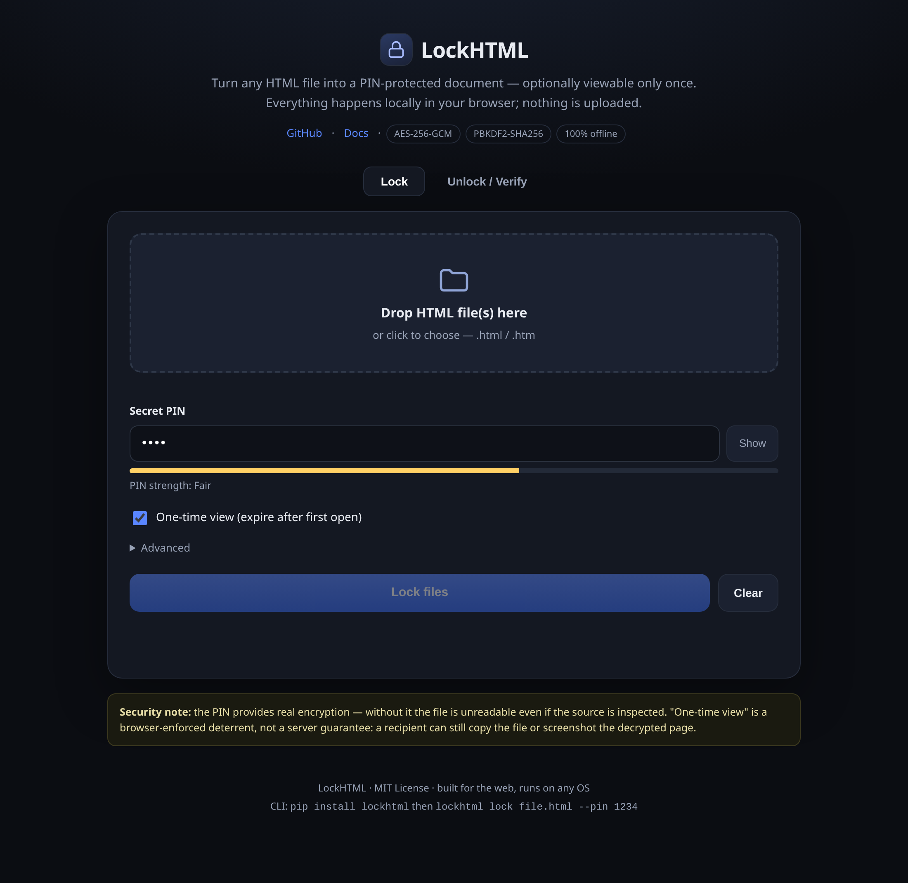
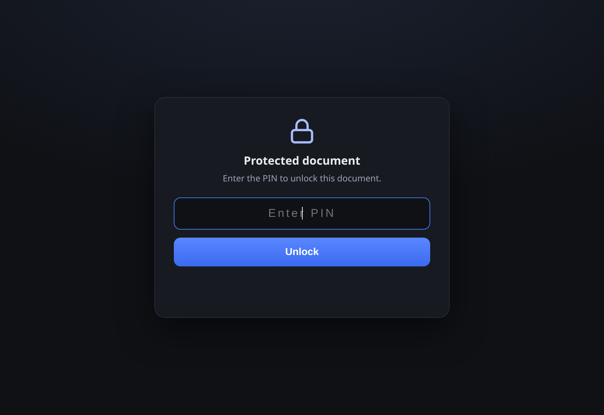

<div align="center">

# 🔒 LockHTML

**Turn any file into a PIN-protected document — optionally viewable only once.**

AES-256-GCM · PIN-protected · one-time view · cross-platform · offline · nothing leaves your device.

[](https://github.com/drsamonline/lockhtml/stargazers)
[](LICENSE)
[](https://github.com/drsamonline/lockhtml/releases)
[](https://pypi.org/project/lockhtml/)
[](#)
[](#)

### 🌐 [Landing page](https://drsamonline.github.io/lockhtml/) &nbsp;•&nbsp; 🚀 [Live demo — open the app](https://drsamonline.github.io/lockhtml/play/)

</div>

---

<div align="center">


**Turn any file into a PIN-protected document — optionally viewable only once.**

AES-256-GCM · Argon2id · unlocks in the browser · runs everywhere · nothing leaves your device.

[](https://github.com/drsamonline/lockhtml/actions/workflows/ci.yml)
[](https://github.com/drsamonline/lockhtml/actions/workflows/pages.yml)
[](https://drsamonline.github.io/lockhtml/play/)
[](https://github.com/drsamonline/lockhtml/releases)
[](LICENSE)
[](https://www.python.org/)
[](#)
[](#how-it-works)
[](#the-gui)
[](CONTRIBUTING.md)
[](https://github.com/drsamonline/lockhtml/stargazers)
[](https://github.com/drsamonline/lockhtml/commits)

</div>

---

**LockHTML** takes an ordinary file — an HTML page, a PDF, a photo, anything — encrypts it with a
key derived from a PIN, and gives you back a single self-contained `.html` file. Anyone who opens it
is asked for the PIN; enter it and the document appears. Choose **one-time view** (or a view limit,
or an expiry date) and it stops opening once the conditions are met.

No server. No accounts. No uploads. The locked file is a normal web page you can email, message or
put on a USB stick — and the GUI works **offline** once loaded.

## ✨ Features

- 🔐 **Argon2id** (memory-hard) by default, with **PBKDF2-SHA256** as a lighter alternative.
- 🔑 **Recipient mode (X25519)** — lock a file to someone's *public key* so only they can open it, with no shared secret; add a PIN on top if you want two factors.
- 🕳️ **Hidden volume** — a second PIN that opens entirely different content, so the file has a plausible cover story.
- 🎛️ **Auto-calibrated KDF** — `--auto-kdf` times this machine and picks the strongest Argon2id cost that still unlocks quickly.
- 🐢 **Constant-memory save** — for large streaming files, decrypt straight to disk chunk-by-chunk (Chromium), instead of building the whole file in memory.
- 🔄 **age interop** — read and write ordinary [age](https://age-encryption.org/v1) files (X25519 recipients), so you can open a file the `age` tool encrypted and vice versa.
- 🧩 **Shamir secret sharing** — split the key into *n* shares so any *k* holders (and no fewer) can open it. Give five people a share; any three can open it.
- 🧂 **Keyfile support** — optionally require a second file in addition to the PIN.
- ✍️ **Ed25519 signing** — sign a locked file so recipients can verify it came from you and wasn't altered.
- 🎭 **Duress PIN** — a second PIN that opens a harmless decoy document instead.
- 👁️ **View limits** — one-time, *N* views, a "do not open before" time, and an expiry time.
- 💧 **Watermarking** — overlay recipient-specific text to trace a leaked copy.
- 📦 **Any file type** — HTML renders inline; everything else is offered as a download.
- 🗂️ **Two containers** — a single self-contained file for documents, or a chunked **streaming bundle** for very large files (video, disk images) at constant memory. See [docs/DESIGN.md](docs/DESIGN.md).
- 🌐 **Browser GUI** — a single self-contained HTML file, installable as a PWA, fully offline.
- 🖥️ **Cross-platform CLI** — one command on Windows, Linux and macOS.
- 🔁 **Reversible** — `lockhtml unlock` recovers the original with the PIN.
- 🌍 **Localised viewer** — English, हिन्दी and ગુજરાતી unlock screens.
- 🧩 **Zero runtime for the recipient** — any modern browser opens a locked file.

## 🚀 Quick start

### GUI (no install)

Open the live app → **<https://drsamonline.github.io/lockhtml/play/>** — or run it locally with the CLI.
Drag in your file, set a PIN, download the locked copy. It works offline after the first load.

### CLI

```bash
pip install lockhtml
```

```bash
# Lock one file with a PIN
lockhtml lock report.html --pin 4821

# One-time view, Argon2id, with a watermark
lockhtml lock report.html --pin 4821 --one-time --watermark "For A. Sharma"

# Expire it and cap the views
lockhtml lock plan.pdf --pin 4821 --max-views 3 --expires 2026-12-31T00:00:00Z

# Require a keyfile as a second factor
lockhtml lock report.html --pin 4821 --keyfile team.key

# Sign it so the recipient can verify authenticity
lockhtml keygen -o sign.pem
lockhtml lock report.html --pin 4821 --sign sign.pem

# Lock to a person's public key (no shared secret)
lockhtml keygen --type x25519 -o alice.pem      # writes alice.pem + alice.pub
lockhtml lock report.html --to alice.pub -o report.locked.html
lockhtml unlock report.locked.html --key alice.pem

# Add a duress PIN that opens a decoy page
lockhtml lock report.html --pin 4821 --decoy-pin 0000

# Split the key: 5 shares, any 3 open it
lockhtml lock report.html --shares 5:3
lockhtml unlock report.locked.html --shares report.locked.shares.txt

# Hide the real file behind a cover, and tune the KDF to this machine
lockhtml lock cover.html --pin 4821 --hidden-pin 0000 --hidden-file real.html --auto-kdf
lockhtml unlock cover.locked.html --pin 0000     # opens the hidden content

# Lock a whole folder
lockhtml lock ./contracts --recursive --pin 4821 --outdir ./locked

# Read and write standard age files (interoperates with the `age` tool)
lockhtml keygen --type age -o key.txt
lockhtml age-encrypt report.pdf -r age1abc…
lockhtml age-decrypt report.pdf.age -i key.txt -o report.pdf

# Large file: streaming container (viewer + sidecar .bin, constant memory)
lockhtml lock holiday.mp4 --pin 4821 --stream

# Recover the original
lockhtml unlock report.locked.html --pin 4821 -o report.html

# Open the browser GUI
lockhtml gui
```

> **Tip:** share the PIN (and keyfile) over a *different* channel than the file.

## 🖥️ The GUI

One self-contained HTML file (`lockhtml/gui/index.html`) — no server, no build step, works offline:

- **Lock tab** — drop in any files, set a PIN (or generate a passphrase), and use the advanced
  panel for the KDF, view limits, expiry, watermark, keyfile and duress PIN.
- **Unlock / Verify tab** — open a locked file with its PIN to preview and recover it.

Because it's plain HTML + Web Crypto (+ a bundled Argon2 WASM), it runs identically in Chrome,
Edge, Firefox, Safari and on Windows, Linux, macOS, Android and iOS. The hosted copy is a
**PWA** — installable, and cached for offline use.

## 📸 Screenshots

<div align="center">

**The GUI — every option, straight from your browser**



<br><br>

**A locked file asks for the PIN before revealing anything**



</div>

## 🔬 How it works

1. Your file is encrypted with **AES-256-GCM**.
2. The key is derived from your PIN with **Argon2id** (or PBKDF2-SHA256) and a random 16-byte salt.
3. If a **keyfile** is used, it is mixed in as a pepper (a post-KDF HMAC), so the PIN alone is not enough.
4. If you **sign**, an Ed25519 signature over the ciphertext is embedded with your public key.
5. The salt, IV and ciphertext are embedded as JSON inside a small *viewer* page.
6. Opening the file runs the viewer, which asks for the PIN and decrypts **in the browser**.
   The plaintext never leaves the device.

```
locked.html = viewer shell + { kdf, params, salt, iv, AES-256-GCM(ciphertext), limits, watermark, sig }
```

The full format is documented in [`docs/FORMAT.md`](docs/FORMAT.md). The CLI (Python) and the GUI
(JavaScript) implement the same format, so files lock and unlock interchangeably across both —
enforced by CI on every push.

### 🔑 Recipient mode

Instead of a shared PIN you can lock a file to someone's **X25519 public key**, so only the holder of
the matching private key can open it. A fresh ephemeral keypair is generated per file, the ECDH
secret goes through HKDF-SHA256, and the result encrypts the file with AES-256-GCM. Because the
shared secret is already 256 bits of entropy, no slow KDF is applied on top — and you can still layer
a PIN (and a keyfile) on top for two factors. It works in the streaming container too.

```bash
lockhtml keygen --type x25519 -o alice.pem   # private (keep) + alice.pub (hand out)
lockhtml lock big.mp4 --to alice.pub --stream
```

### 🔄 age interop

LockHTML reads and writes standard [age](https://age-encryption.org/v1) files, so it interoperates
with the `age` tool. Supported: the v1 header and its MAC, `X25519` recipients and identities, the
64 KiB STREAM payload, and multiple recipients per file. Not supported: `scrypt` passphrases, the
ML-KEM hybrid and P-256 tagged recipients, and ASCII armor.

```bash
lockhtml keygen --type age -o key.txt        # an age identity; prints the recipient
lockhtml age-encrypt report.pdf -r age1abc…  # -> report.pdf.age
lockhtml age-decrypt report.pdf.age -i key.txt -o report.pdf
```

age uses ChaCha20-Poly1305, which Web Crypto does not expose, so this is **CLI-only** — the HTML
viewer and GUI cannot open age files. Interoperability is verified against the reference
implementation in both directions; see [docs/AGE.md](docs/AGE.md).

### 🧩 Shamir secret sharing

Split a file's key so that any *k* of *n* holders can open it and no fewer can. A random 32-byte seed
is split with Shamir's scheme over **GF(256)**; the seed feeds HKDF-SHA256 to produce the AES key.
The shares are written to a `.shares.txt` file that you distribute **separately** — the locked file
alone cannot be opened. It works in the streaming container and can be combined with a PIN and a
keyfile.

```bash
lockhtml lock report.html --shares 5:3      # writes report.locked.html + report.locked.shares.txt
lockhtml unlock report.locked.html --shares some-three.txt
lockhtml unlock report.locked.html --share <b64> --share <b64> --share <b64>
```

### 🚀 Launchers (no install needed)

The repo ships small launcher scripts that run the CLI straight from the checkout — handy on a
machine where you have not `pip install`ed anything:

| Platform | CLI | GUI |
| --- | --- | --- |
| Linux / macOS | `./lockhtml.sh …` (or `sh lockhtml.sh …`) | `./gui.sh` |
| Windows | `lockhtml.bat …` | `gui.bat` |

They find Python 3.9+, prefer a local `.venv`, check the two dependencies, and give a clear message
if something is missing. On Windows the `.bat` files are directly runnable; on Unix, mark them
executable once with `chmod +x lockhtml.sh gui.sh` (or just run them through `sh`).

### 🕳️ Hidden volume

A locked file can carry more than one payload. The **cover** content opens with the main PIN, and a
second PIN opens **hidden** content — different bytes entirely, with no indication in the file that
it exists. This is the same idea as the duress PIN, generalised: you can add several hidden slots.

```bash
lockhtml lock cover.html --pin 4821 --hidden-pin 0000 --hidden-file real.html
```

A hidden volume is **plausible deniability, not proof of absence**: someone who knows the format can
see that extra encrypted slots exist, they just cannot read them. See [SECURITY.md](SECURITY.md).

### 📦 Containers and size limits

The default **embedded** container puts the ciphertext inside the HTML as base64. That is the most
convenient form — one file the recipient can just open — but memory use is roughly **3–4× the file
size**, so it is comfortable to about 50 MB and breaks somewhere around 250–300 MB (the browser's
single-string limit is ~512 MB, and base64 inflates by 33%).

For bigger files use `--stream`, which writes the ciphertext to a sidecar `.bin` in fixed-size
chunks. Reading and decryption then cost **~O(chunk size)** instead of O(file size), so
multi-gigabyte files work. The trade-off is that the recipient receives **two files**.

| | Embedded (default) | Streaming (`--stream`) |
| --- | --- | --- |
| Files the recipient gets | 1 | 2 (`.html` + `.bin`) |
| Practical size ceiling | ~250–300 MB | Limited by disk |
| Memory to encrypt/decrypt | ~3.7× file size | ~O(chunk size) |
| Size overhead | ≈33% (base64) | ≈16 bytes per chunk |

Neither mode touches the network — "streaming" here means *memory*, not the internet. Full
reasoning, the memory arithmetic and the chunk format are in **[docs/DESIGN.md](docs/DESIGN.md)**.

## 🛡️ Security model — read this

**The PIN (and keyfile) gives you real encryption.** Without them the file is unreadable even if
someone opens it in a text editor. Wrong PINs are rejected cryptographically (AES-GCM
authentication), not by a string comparison. Signatures are verified before the content is shown.

**The view limits, watermark and one-time view are browser-enforced deterrents, not server
guarantees.** Since there is no server, the view counter lives in the browser's IndexedDB. A
determined recipient can copy the file first, use another browser or profile, clear their storage,
or screenshot the decrypted page. These features stop casual re-sharing and help you trace a leak;
they are not a hard guarantee.

**This is not a substitute for end-to-end tools** when the stakes are high (medical records,
credentials, legal documents). Once a recipient decrypts, the content is on their screen and in
their memory. For genuinely enforced single-view delivery, use a server that deletes the document
after the first fetch.

| Property | Guarantee |
| --- | --- |
| Content unreadable without PIN | ✅ Strong (AES-256-GCM + Argon2id) |
| Content unreadable without the private key | ✅ Strong (X25519 + HKDF) |
| Content unreadable with fewer than k shares | ✅ Strong (Shamir over GF(256)) |
| Wrong PIN rejected | ✅ Strong (authenticated encryption) |
| Keyfile required as a second factor | ✅ Strong (pepper) |
| Authenticity (sender identity) | ✅ Strong when signed (Ed25519) |
| Works offline / no upload | ✅ Yes |
| Truly view-once / expiry | ⚠️ Best-effort (client-side) |
| Survives a determined recipient | ❌ No |

See [`SECURITY.md`](SECURITY.md) and the self-audit in [`docs/AUDIT.md`](docs/AUDIT.md).

## 📂 Project layout

```
lockhtml/
├── lockhtml/
│   ├── core.py                 # crypto + payload format v2
│   ├── cli.py                  # command-line interface
│   ├── templates/
│   │   ├── viewer.src.html     # viewer source (generated files below)
│   │   ├── viewer.html         # PBKDF2-only viewer (small)
│   │   └── viewer-argon2.html  # viewer with Argon2id WASM inlined
│   └── gui/
│       ├── app.html            # GUI source
│       ├── index.html          # generated, self-contained GUI
│       ├── manifest.webmanifest, sw.js, icon.svg   # PWA
├── tools/
│   ├── build.py                # builds the viewer variants + GUI
│   ├── minify.mjs              # minifies the generated assets
│   ├── check_gui_compat.mjs    # cross-implementation check (run in CI)
│   ├── e2e_fixtures.py         # builds fixtures for the browser test
│   ├── e2e_browser.mjs         # end-to-end browser test (embedded + streaming)
│   ├── e2e_gui.mjs             # locks files with the GUI code path
│   └── e2e_gui_verify.py       # verifies those with the Python core
├── docs/                       # design notes, format spec, audit
├── tests/                      # crypto + CLI tests
├── examples/                   # sample.html and its locked twin
└── .github/workflows/          # CI + GitHub Pages deploy
```

## 🤝 Contributing

Issues and pull requests are welcome — see [CONTRIBUTING.md](CONTRIBUTING.md). Planned work lives in
[ROADMAP.md](ROADMAP.md).

```bash
git clone https://github.com/drsamonline/lockhtml
cd lockhtml
pip install -e ".[dev]"
npm install          # build tooling: minifier + Argon2 WASM
make test            # run the test suite
make build           # regenerate + minify the GUI and viewers
```

## 📜 License

[MIT](LICENSE) © Dr Sohil Momin

<div align="center"><sub>Built for the web. Runs on any OS. Nothing leaves your device.</sub></div>
